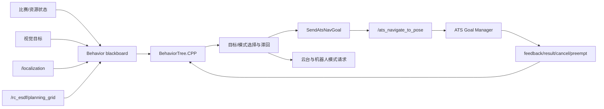

# ATS Sentry Behavior

**面向 RoboMaster 哨兵的 ROS 2 行为树决策与 ATS 导航目标编排仓库**

> 正式运行只使用 `/ats_navigate_to_pose` 和 `SendAtsNavGoal`。本仓当前 manifest、
> CMake 和插件列表均不依赖 Nav2 action，也不存在正式运行时 Nav2 回退。

## 项目简介

`ats_sentry_behavior` 负责把比赛阶段、裁判系统资源、视觉目标、定位状态和规划地图转换成
可取消、可抢占的导航目标，以及云台、底盘自旋和机器人工作模式请求。

行为层决定“去哪里、何时切换、何时取消”，但不拥有地图融合、路径安全、轨迹优化、
MPC 或底盘最终速度授权。导航安全与运动执行仍由 Goal Manager、MINCO、MPC 和串口安全链负责。

## 目录

- [技术亮点](#技术亮点)
- [功能模块](#功能模块)
- [系统依赖](#系统依赖)
- [Quick Start](#quick-start)
- [启动与部署](#启动与部署)
- [接口与数据流](#接口与数据流)
- [配置与行为树资产](#配置与行为树资产)
- [运行检查](#运行检查)
- [测试与验证边界](#测试与验证边界)
- [目录结构](#目录结构)
- [致谢与许可证](#致谢与许可证)

## 技术亮点

### 单一 ATS 导航 Action

`SendAtsNavGoal` 使用
`ats_navigation_interfaces/action/NavigateToPose`，action server 默认为
`/ats_navigate_to_pose`。插件处理：

- goal accepted、planning、tracking 等 feedback；
- succeeded、canceled、preempted、timeout、map/TF/planning failure result；
- 行为树 halt 向远端 action 传播 cancel；
- 新目标替换和迟到 result 隔离；
- 多航点路径按顺序推进。

行为树停止 tick 并不等价于远端 goal 已取消，因此 halt/cancel 传播是本仓的安全契约，
已有真实 action server GTest 覆盖。

### 比赛状态与资源策略

行为黑板融合比赛阶段、剩余时间、血量、弹量、RFID、受击状态和补给状态，支持巡逻、
补给、低血量撤退、关键时间目标与锚点策略。模式切换具有 cooldown 和累计时长约束，
防止状态边界附近频繁抖动。

### 视觉接管与可通行性筛选

视觉接管不是直接把目标位置发送给底盘。`SelectVisionFollowPath` 在目标周围生成候选点，
结合 `/rc_esdf/planning_grid` 的 occupied 阈值、clearance、可达性、路径长度、目标侧保持和
角度步长选择跟随目标，并用滞回与最小重规划间隔抑制跳变。

### 决策与执行解耦

行为树输出导航意图和模式请求；Goal Manager 负责 action 生命周期、地图/定位健康、
reference 提交和 `ExecutionCommand`；MPC/serial 只有在有效执行授权存在时才能输出非零速度。
单独发布 goal、裸 Twist 或 `emergency_stop=false` 均不应绕过正式执行授权。

## 功能模块

| 模块 | 主要实现 | 职责 |
| :--- | :--- | :--- |
| 行为树 server | `ats_sentry_behavior_server` | 注册插件、加载 XML、维护黑板并 tick 行为树 |
| 行为树 client | `ats_sentry_behavior_client` | 请求并监控目标行为树 |
| ATS 导航 action | `SendAtsNavGoal` | 发送目标、处理 feedback/result、halt/cancel 与多航点推进 |
| 固定/巡逻/补给目标 | `SelectFixedPath`、`SelectPatrolPath`、`SelectSupplyPoint` | 从参数或 CSV 选择目标序列 |
| 低血量撤退 | `SelectNearestRetreatPath` | 按当前位姿选择候选撤退点 |
| 视觉跟随 | `SelectVisionFollowPath` | 用 planning grid 筛选、排序并稳定跟随目标 |
| 资源与比赛条件 | `IsGameStatus`、`IsHpBand`、`IsRobotResourceMode` 等 | 把裁判和资源状态映射为行为条件 |
| 云台/模式输出 | `PubGimbal*`、`PubRobotMode`、`PubSpinSpeed` | 发布云台、机器人模式和自旋请求 |
| 控制/装饰器 | `RecoveryNode`、`RateController`、`TickAfterTimeout` | 组织恢复、节流和超时行为 |

## 系统依赖

### 基础环境

- Ubuntu 22.04；
- ROS 2 Humble；
- C++17 与 CMake；
- BehaviorTree.CPP；
- BehaviorTree.ROS2 / `behaviortree_ros2`；
- `ats_navigation_interfaces`、`ats_rm_interfaces`、`sp_msgs`；
- `rclcpp`、`rclcpp_action`、TF2 及常用 ROS message 包。

仓库内 `dependencies.repos` 记录了无法仅靠系统包表达的依赖，包括
BehaviorTree.ROS2、`ats_rm_interfaces`/`sp_msgs` 所在的 interfaces 仓，以及提供
`ats_navigation_interfaces` 的自研导航仓：

```bash
cd /home/ats/ATS_2026_snetry_test
vcs import src < src/ats_sentry_behavior/dependencies.repos
```

在已有工作区中执行前先检查目标目录，避免覆盖用户已有 clone。随后使用 `rosdep` 安装可解析依赖：

```bash
source /opt/ros/humble/setup.bash
rosdep install --from-paths src --ignore-src -r -y
```

## Quick Start

### 构建

从 ATS 工作区根目录执行：

```bash
cd /home/ats/ATS_2026_snetry_test
source /opt/ros/humble/setup.bash
MAKEFLAGS=-j6 colcon build --base-paths src --symlink-install \
  --packages-up-to ats_sentry_behavior \
  --parallel-workers 6
source install/setup.bash
```

建议保留 `--base-paths src`，避免参考目录或同名包进入构建图。

### 检查 Launch 参数

```bash
ros2 launch ats_sentry_behavior ats_sentry_behavior_launch.py --show-args
```

`params_file` 没有包内默认值，standalone 启动建议显式传入。

## 启动与部署

### 正式整机部署

根 bringup 会启动行为 server/client，并把统一 `node_params.yaml` 传给两个节点：

```bash
ros2 launch ats_sentry_bringup real_robot_navigation.launch.py \
  world:=rmuc_2026 \
  launch_behavior:=true
```

该入口还会启动定位、ROGMap、adapter、Goal Manager、MINCO、MPC 和底盘链。行为树不是
可独立替代这些组件的导航系统。

### Standalone 调试

```bash
ros2 launch ats_sentry_behavior ats_sentry_behavior_launch.py \
  params_file:=/home/ats/ATS_2026_snetry_test/src/ats_sentry_bringup/params/node_params.yaml
```

使用包内示例参数时建议明确选择：

```bash
ros2 launch ats_sentry_behavior ats_sentry_behavior_launch.py \
  params_file:=/home/ats/ATS_2026_snetry_test/src/ats_sentry_behavior/params/sentry_behavior.example.yaml
```

`sentry_behavior.example.yaml` 只用于 standalone 示例，不是正式 profile 的参数来源。

### 切换行为树

正式 behavior client 的 `target_tree` 位于统一参数文件中，例如：

```yaml
ats_sentry_behavior_client:
  ros__parameters:
    target_tree: rmuc_2026_mapping
```

切换前应确认目标 XML 已安装、依赖插件已注册、CSV/黑板键与新树一致，并先在无底盘授权环境中
验证树的优先级和 halt 传播。

## 接口与数据流

### 导航 Action

| 名称 | 类型 | 方向 | 语义 |
| :--- | :--- | :--- | :--- |
| `/ats_navigate_to_pose` | `ats_navigation_interfaces/action/NavigateToPose` | behavior -> Goal Manager | goal、feedback、result、cancel、preempt、timeout |
| `ats_sentry_behavior` | BehaviorTree.ROS2 action | client -> behavior server | 请求执行指定行为树 |

正式插件列表只有 `SendAtsNavGoal`；不应在 XML、参数或部署脚本中填写
`/navigate_to_pose`、`/navigate_through_poses` 或 Nav2 navigator server。

### 主要输入

| 输入 | 默认正式接口 | 用途 |
| :--- | :--- | :--- |
| 当前位姿 | `/localization`，`nav_msgs/msg/Odometry` | 固定点、撤退点、到达判定与视觉跟随 |
| 规划地图 | `/rc_esdf/planning_grid`，`nav_msgs/msg/OccupancyGrid` | 视觉候选碰撞和可达性检查 |
| 视觉目标 | `vision/target`，`sp_msgs/msg/VisionTargetMsg` | 目标有效性、位置与跟随策略 |
| 裁判/资源状态 | `ats_rm_interfaces` 相关消息 | 比赛阶段、血量、弹量、RFID、受击和补给 |
| 仿真模式 | `decision/sim_mode` | 无裁判系统测试时选择决策模式 |

正式参数中 planning grid 使用 RELIABLE + TRANSIENT_LOCAL，定位输入使用 BEST_EFFORT
latest-data 语义；两个输入都有 timeout，过期数据不能继续产生新的安全导航意图。

### 主要输出

| 输出 | 默认接口 | 说明 |
| :--- | :--- | :--- |
| 导航意图 | `/ats_navigate_to_pose` | 由 `SendAtsNavGoal` 发送，不是底盘速度 |
| 自旋请求 | `cmd_spin` | 行为层期望自旋速度/模式 |
| 云台请求 | `cmd_gimbal` | 云台速度或绝对角请求 |
| 机器人模式 | `decision/robot_mode` | 供串口/底盘模式链消费 |
| 模式诊断 | `decision/robot_mode_markers` | RViz MarkerArray |
| 视觉跟随诊断 | `decision/vision_follow_markers` | 候选点与选择结果 MarkerArray |

### 数据流



## 配置与行为树资产

### 参数权威

正式参数唯一权威：

```text
src/ats_sentry_bringup/params/node_params.yaml
```

相关节点段：

- `ats_sentry_behavior_server`：插件目录、树目录、tick rate、决策参数、topic、视觉和资源策略；
- `ats_sentry_behavior_client`：目标树和重试间隔；
- `standard_robot_pp_ros2`：最终机器人模式、执行授权和串口安全参数。

### 资产边界

| 文件/目录 | 作用 | 是否进入总 YAML |
| :--- | :--- | :--- |
| `params/sentry_behavior.example.yaml` | standalone 示例 | 否，需显式传入 |
| `params/sentry_behavior_decision_vision_test.yaml` | 视觉专项测试 | 否，测试显式选择 |
| `behavior_trees/*.xml` | 行为树拓扑 | 否，XML 保持独立 |
| `params/rmuc_waypoints.csv` | 场地语义目标点 | 否，CSV 保持独立 |
| `params/rmuc_patrol_waypoints.csv` | 巡逻顺序 | 否，CSV 保持独立 |
| `ats_navigation_interfaces/action/*.action` | action schema | 否，接口定义是独立权威 |

统一 YAML 只统一可调 ROS 参数、topic、frame、QoS 和 timeout。不要把树拓扑、航点表或接口
schema 复制成 YAML 字符串，否则会产生多个不一致权威。

## 运行检查

启动后可核对 action 所有权：

```bash
ros2 action info /ats_navigate_to_pose
ros2 node info /ats_sentry_behavior_server
ros2 node info /ats_sentry_behavior_client
```

期望只有 `ats_goal_manager` 提供导航 action server，行为端为 client。检查运行图中没有 Nav2：

```bash
ros2 node list --no-daemon | rg 'bt_navigator|planner_server|controller_server|behavior_server'
ros2 topic list --no-daemon | rg '^/plan$|costmap'
```

上述两条在正式链应无匹配输出。topic/action 存在只能证明发现，不能替代 goal
feedback/result、halt/cancel 和底盘停止的闭环验证。

## 测试与验证边界

### 包级测试

```bash
colcon test --base-paths src --packages-select ats_sentry_behavior
colcon test-result --test-result-base build/ats_sentry_behavior --verbose
```

主要定向测试：

| 测试 | 覆盖内容 |
| :--- | :--- |
| `test_ats_nav_goal_logic` | ATS result 判据、航点推进和本地目标逻辑 |
| `test_official_tree_priority` | 真实正式 XML 的优先级与 halt 传播 |
| `test_send_ats_nav_goal_action` | 真实 action server 下的 cancel、迟到 result、结果码和多航点 |

最近一次 S1/P4 准备阶段记录：behavior action 定向测试通过；迁移前后 behavior
server/client effective parameter dump 的键、值和类型一致；MuJoCo rectangle 的五段 action
运行通过。

仍需保留以下边界：

- 完整实机根入口在当前工作站曾受缺失 xmacro 资产阻断，standalone effective dump
  不能替代完整实机启动复验；
- HIL、实车 cancel/preempt、比赛全状态长时运行尚未验收；
- 包级 lint 存在既有 copyright/cpplint/clang-format 债务时，应单列，建议避免把定向测试通过写成
  全包测试通过。

## 目录结构

```text
ats_sentry_behavior/
├── behavior_trees/                 # 正式、映射、巡逻和视觉测试树
├── include/ats_sentry_behavior/    # server/client、插件头文件和决策工具
├── plugins/
│   ├── action/                     # 导航、目标、云台、模式 action nodes
│   ├── condition/                  # 比赛、资源、视觉 condition nodes
│   ├── control/                    # recovery control node
│   └── decorator/                  # rate/timeout decorators
├── src/                            # behavior server 与 client
├── launch/                         # standalone launch，强制 params_file
├── params/                         # example、测试参数和 waypoint CSV
├── test/                           # 逻辑、正式树与 action GTest
├── dependencies.repos              # BehaviorTree.ROS2、interfaces 和导航 action 来源
├── CMakeLists.txt
└── package.xml
```

## 致谢与许可证

感谢以下开源项目与社区：

| 项目 | 在本仓中的用途 | 上游 |
| :--- | :--- | :--- |
| BehaviorTree.CPP | 行为树运行时、节点模型、黑板和 XML 树 | [BehaviorTree/BehaviorTree.CPP](https://github.com/BehaviorTree/BehaviorTree.CPP) |
| BehaviorTree.ROS2 | ROS 2 action/service 与行为树集成 | [BehaviorTree/BehaviorTree.ROS2](https://github.com/BehaviorTree/BehaviorTree.ROS2) |
| ROS 2 | 节点、Action、Topic、TF、launch 和测试工具 | [ros2/ros2](https://github.com/ros2/ros2) |
| SMBU PolarBear Robotics Team | BehaviorTree.ROS2 Humble fork、ATS 接口与工程集成 | [SMBU-PolarBear-Robotics-Team](https://github.com/SMBU-PolarBear-Robotics-Team) |

本仓采用 Apache-2.0，具体见 `LICENSE` 和 `package.xml`。BehaviorTree.CPP、
BehaviorTree.ROS2、ATS interfaces 及其他依赖保留各自许可证与版权；再分发时以各上游声明为准。
